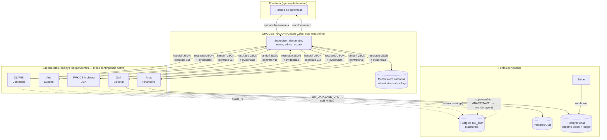

# Arquitetura do Sistema de Orquestração Multiagente — The World Keys

> Versão 1.0 · 2026-08-12 · Arquiteto-Chefe: Claude (Fase 0–3 executadas neste repositório)

## SUPOSIÇÕES

Declaradas por escrito porque não foram confirmadas pelo fundador (que delegou as decisões):

1. **Todos os agentes estão em teste, não em produção oficial** (confirmado pelo fundador em 2026-08-12). O rollout parte de modo sombra sem exceção.
2. **Topologia de bancos** (inferida dos `.env`): Comercial, Suporte e DBA usam o Postgres da plataforma (`twk_auth`, Cloud SQL, IP 35.239.247.237); Editorial e Financeiro têm bancos próprios. Não confirmado por acesso direto.
3. **Aprovações humanas mínimas** (definidas por mim, padrão conservador): reembolso/desconto de qualquer valor, mudança de `published`, DELETE/DDL/migração em qualquer banco, envio externo (e-mail/WhatsApp/publicação), má notícia a cliente. Afrouxar exige decisão explícita do fundador.
4. **Sem teto oficial de custo** (confirmado). Adotei tetos operacionais próprios: €50/dia por agente, €10 por tarefa orquestrada, 8 passos por cadeia — reviso com dados do modo sombra.
5. **O Orquestrador roda neste workspace via Claude Code**, com o fundador como operador. Ele NÃO é um serviço 24/7; os 5 agentes continuam autônomos em seus deploys (EasyPanel). Promover o Orquestrador a serviço é decisão futura, tomada com métricas do piloto.
6. **Fluxo piloto** (minha escolha, justificada pelo incidente real): **publicação de restaurante** (DBA → Editorial → Comercial), porque é onde a operação já perdeu dinheiro de forma comprovada (985 páginas fora do ar, 47 com demanda ativa). O fluxo "venda → onboarding → cobrança" vem em seguida.

## 1. Padrão arquitetural: Supervisor / Orchestrator-Workers

- O Orquestrador **coordena, não executa**: nunca escreve copy, nunca roda SQL de negócio, nunca responde cliente. Sua única escrita é em `orchestrator/state` e `orchestrator/logs`.
- Todo repasse usa o contrato `orchestrator/contracts/handoff.schema.json` (task_id, trace_id, origem, destino, objetivo, contexto_minimo, prazo, prioridade, criterio_de_pronto, autonomia, orçamento). Contexto mínimo = referências (ids, códigos), nunca dumps nem PII.

## 2. Dados e memória em camadas

| Camada | Onde | Conteúdo | Retenção |
|---|---|---|---|
| **Operacional (quente)** | `orchestrator/state/tasks.jsonl` + `current_trace.txt` | Tarefas em andamento: fila, status, responsável, bloqueios | Compactada ao concluir |
| **Conhecimento (morna)** | `orchestrator/state/conhecimento.md` | Fatos consolidados: donos de dados, políticas, tom, decisões do fundador | Atualizada por edição consciente |
| **Auditoria (fria)** | `orchestrator/logs/audit-AAAA-MM-DD.jsonl` | Log imutável (append-only) de decisão, handoff, ação e bloqueio de guardrail, com timestamp e trace_id | Permanente |

**Menor privilégio sobre conteúdo:** o Orquestrador tem visão total dos **metadados** (quem fez o quê, quando, com que resultado) e acesso mínimo a dados brutos: ele sabe QUE existe cobrança em aberto do parceiro X (referência `task/customer_id`), nunca armazena valores de cartão, alergias, e-mails de clientes ou texto integral de conversas.

**Fonte única de verdade por dado** — tabela completa em `docs/auditoria/matriz-dependencias.md` (catálogo=DBA, texto editorial=Editorial, reservas=plataforma, receita=Financeiro, consentimento=Suporte, funil=Comercial, orquestração=Orquestrador). Regra: o resto **consulta, nunca duplica**.

## 3. Resiliência e controle

- **Degradação graciosa:** os 5 agentes já operam independentes (é o estado atual) — a queda do Orquestrador devolve a operação exatamente ao modo de hoje. Nenhum agente espera o Orquestrador para funcionar; handoffs pendentes ficam em `tasks.jsonl` e são retomados.
- **Circuit breakers/retries:** exigidos de cada agente nas suas integrações (CLAVIS e Atlas já têm; Aria parcial; lacunas viraram recomendações nos dossiês). O Orquestrador aplica retry com backoff a handoffs e marca `bloqueada` após 2 falhas.
- **Limites por tarefa:** `orcamento.max_passos` ≤ 8 (default) e ≤ 20 (teto duro), custo estimado por tarefa ≤ €10 sem revisão. Estourou → para e devolve parcial com status `bloqueada`.
- **Human-in-the-loop obrigatório** (tabela normativa no `CLAUDE.md`): reembolso/desconto, DELETE/DROP/migração, mudança de `published`, envio externo, publicação de conteúdo, má notícia a cliente.
- **Guardrails determinísticos** (hooks, não prompt): `guard-sql.ps1` bloqueia SQL destrutivo com exit 2; `log-action.ps1` audita toda ação; `validate-handoff.ps1` valida contratos de retorno. Testes adversariais em `orchestrator/tests/test-guards.ps1`.

## 4. Observabilidade

- JSONL estruturado com `trace_id` propagado pela cadeia inteira — qualquer tarefa reconstruível de ponta a ponta com `/auditoria <trace_id>`.
- **Painel diário** via `/briefing` (gerado de `tasks.jsonl` + logs + saúde dos agentes): concluídas/travadas por agente, custo, escalonamentos, anomalias — resposta em ≤30s.
- Alertas (fase sombra: no briefing; fase piloto: push via n8n): fila parada >24h, agente em loop (passos>teto), custo anômalo (>3× média), guardrail_block repetido.

## 5. Economia de modelo

| Papel | Modelo | Justificativa |
|---|---|---|
| Orquestrador (decomposição, arbitragem, conflito) | O mais capaz disponível (Fable/Opus) | Erro de roteamento custa caro em cascata; volume baixo |
| Especialistas (subagentes locais de análise) | Sonnet | Equilíbrio qualidade/custo; é o que os agentes reais já usam |
| Triagem/classificação (rótulos, dedup, checks) | Haiku | Já validado por Aria (scopeGuard) e Quill (editor-chefe) |
| Serviços em produção | Mantêm seus modelos atuais | O Orquestrador não muda o runtime dos agentes |

## 6. Decisões registradas

ADRs em `docs/adr/`: ADR-001 (padrão supervisor), ADR-002 (orquestração via Claude Code, não serviço), ADR-003 (handoff por contrato JSON), ADR-004 (fonte única de verdade), ADR-005 (guardrails por hook determinístico), ADR-006 (rollout em sombra e piloto de publicação).

## 7. Rollout

1. **Sombra (semana 1):** Orquestrador só observa — `/briefing` diário sobre o estado real dos 5 agentes; valida telemetria e correções P0 dos dossiês.
2. **Piloto (semana 2):** fluxo de publicação de restaurante ponta-a-ponta (reconciliação das 979 páginas no limbo é o caso de teste real, com aprovação humana para cada republicação em lote).
3. **Expansão:** venda→onboarding→cobrança; depois opt-out unificado.
4. **Reversão:** se KPI-chave piorar >10% por 3 dias (publicados, tempo de resposta Aria, custo/dia), o fluxo volta ao modo independente — basta parar de rotear pelo Orquestrador (nada a desinstalar).
